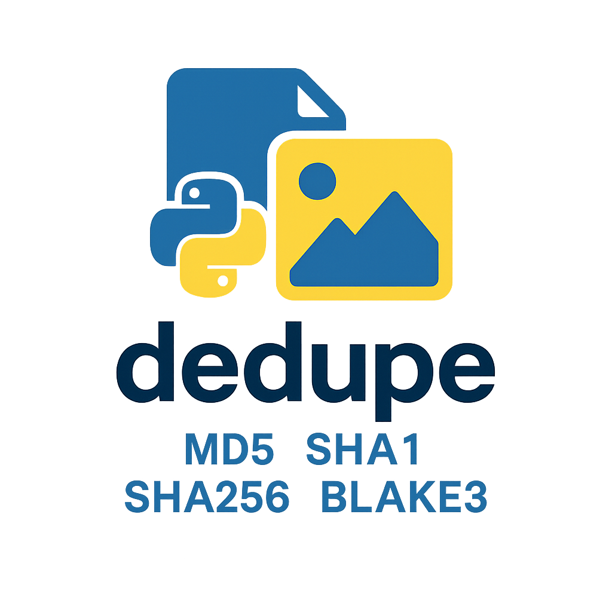

[](https://github.com/isaiah1112/dedupe/actions/workflows/python-tests.yml)

`dedupe` finds duplicate files in a directory by comparing their hashes. It checks files directly inside the selected directory (not recursively) and skips hidden files and subdirectories.

## Getting Started
Python 3.11 or newer is required. The Makefile uses `uv` by default and installs it automatically when needed.

### Using make
```commandline
make install
```

This creates or updates the project virtual environment in `.venv`. Activate it with:

```commandline
source .venv/bin/activate
```

To install with pip instead of uv:
```commandline
make install UV_INSTALL=0
```

## Usage

After installation, the `dedupe` command will be available in your environment.

### Find duplicates

By default, `dedupe` uses MD5 and moves all but one file from each duplicate group into a `duplicates/` subdirectory inside the selected folder:

```commandline
dedupe ~/Pictures/Wallpapers
```

Choose another supported algorithm with `--hash` (`md5`, `sha1`, `sha256`, or `blake3`):

```commandline
dedupe --hash sha1 ~/Documents
dedupe --hash sha256 ~/Videos
dedupe --hash blake3 ~/Downloads
```

When duplicates are found, output looks like:
```
Found 1 duplicate file(s)!
Duplicate files moved to: ~/Pictures/Wallpapers/duplicates/
```

If no duplicates are found, it prints:
```
No duplicate files found
```

### Remove duplicates

Use `--remove` to permanently delete the extra copies instead of moving them. This cannot be undone:

```commandline
dedupe --remove ~/MyFolder
```

When duplicates are removed, it prints:
```
Found 1 duplicate file(s)!
Duplicate files removed!
```

### Debug mode

Use `--debug` (or `-d`) to enable diagnostic logging:

```commandline
dedupe --debug ~/SomeFolder
```

## Development

Install the project and its test tools, then run the checks with:

```commandline
make lint
make test
```

To run the unit tests and print a coverage report with missing lines:

```commandline
make coverage
```

To run tests in Docker for a specific Python version:

```commandline
make docker-test PYTHON_VERSION=3.15
```

To run the tests across all supported Python versions:

```commandline
make docker-test-all
```